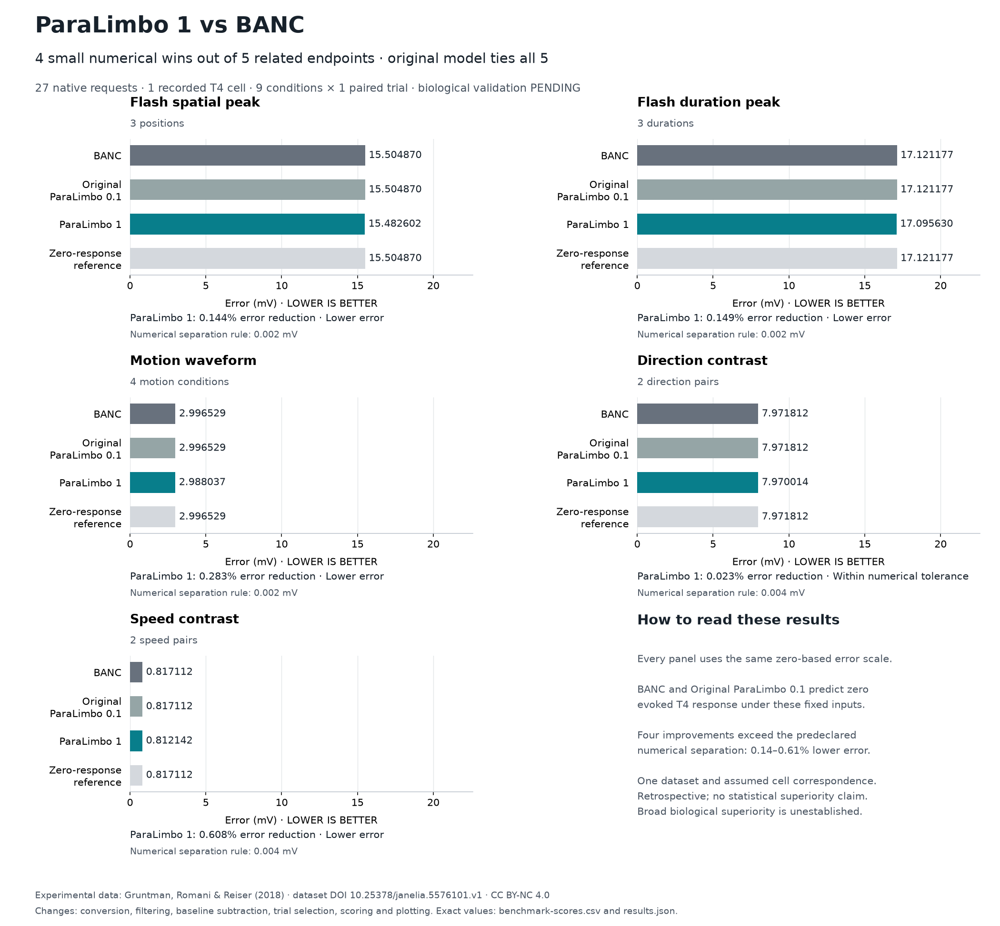

# ParaLimbo 1

**ParaLimbo 1 has lower error than BANC on 4 of 5 scored endpoints under the frozen numerical separation rules.** Error reductions on those four endpoints are **0.14–0.61%**. Original ParaLimbo 0.1 ties BANC exactly on every endpoint.

**Biological validation: PENDING.** These are five related measurements from **one dataset, one recorded T4 cell, nine conditions and one paired trial per condition**. BANC and Original ParaLimbo 0.1 produce exactly zero evoked selected-T4 response under the fixed, uncalibrated sensory inputs. General biological superiority remains unestablished.



[Interactive benchmarks](benchmarks.html) · [Scalable figure](benchmark-overview.svg) · [Exact score CSV](benchmark-scores.csv) · [All comparison CSV](comparisons.csv) · [Scored data and traces](results.json) · [Model card](MODEL_CARD.md) · [Methods](METHODS.md) · [Evidence identities](EVIDENCE.md)

Download `benchmarks.html` and open it in a browser to inspect all five graphs, exact values and nine recorded-trial comparisons. The chart libraries are bundled for offline viewing. GitHub's file viewer displays the HTML source; the PNG above renders directly in this README.

## Clear comparative results

| Endpoint · mV, lower is better | BANC | Original ParaLimbo 0.1 | ParaLimbo 1 | Zero reference | Error reduction vs BANC | Numerical verdict |
|---|---:|---:|---:|---:|---:|---|
| Flash spatial peak | 15.504870389 | 15.504870389 | 15.482602188 | 15.504870389 | 0.143621% | Lower error |
| Flash duration peak | 17.121177023 | 17.121177023 | 17.095630231 | 17.121177023 | 0.149212% | Lower error |
| Motion waveform | 2.996528867 | 2.996528867 | 2.988036843 | 2.996528867 | 0.283395% | Lower error |
| Direction contrast | 7.971811893 | 7.971811893 | 7.970014447 | 7.971811893 | 0.022548% | Within numerical tolerance |
| Speed contrast | 0.817112084 | 0.817112084 | 0.812141669 | 0.817112084 | 0.608291% | Lower error |

The table displays nine decimal places; the CSV and JSON retain the full scored floating-point values. Error reduction is `(BANC error − ParaLimbo 1 error) / BANC error × 100`.

The direction-contrast error is also smaller, by **0.001797447 mV (0.022548%)**, but this is below its **0.004 mV** numerical separation rule. It is reported as within tolerance. The first three endpoints use **0.002 mV** separation; direction and speed use **0.004 mV**. These are numerical reporting thresholds, with no claim of statistical significance or biological meaningfulness.

## What was run

**27/27 native prediction requests completed and passed qualification:** three model variants × nine conditions. All **15 model-endpoint scores**, **five zero-response reference scores**, and **ten candidate-versus-BANC comparisons** are included. Each request used the full **175,401-neuron** graph and underwent timestep refinement, optical-reference checks, complete-state disk restore/replay, and observation/input checks.

The completed local independent audit passed **23,583 checks with zero findings**. Public score arithmetic can be checked from this repository:

```sh
python3 scripts/verify_paralimbo_1_publication.py
```

That check recalculates the published results and verifies release evidence; it does not rerun the full native experiment. Native reruns additionally require the pinned graph and source inputs described in the [model package](../../models/paralimbo-1/) and [methods](METHODS.md).

## Model name and scope

**ParaLimbo 1** is the public name for the tested graded candidate with frozen internal identity `paralimbo-visual-graded-v1`. The label does not change its scientific identity or sealed predictions. Original ParaLimbo 0.1 remains `paralimbo-v0-1-0`; BANC remains `banc-888`.

The four small wins are descriptive results under assumed sensory dynamics and an assumed T4c correspondence. Historical observations were previously exposed; these are retrospective comparisons. Only one recorded cell and one selected trial per condition were scored. No confidence interval, statistical superiority, independent replication or optimized-BANC claim is made. All model scores exceed the frozen **0.05 mV** error reporting target.

## Data credit and rights

Recorded responses derive from **Gruntman, Romani & Reiser (2018)**, [paper](https://doi.org/10.1038/s41593-017-0046-4), [dataset v1](https://doi.org/10.25378/janelia.5576101.v1), licensed **[CC BY-NC 4.0](https://creativecommons.org/licenses/by-nc/4.0/)**. Changes include conversion, filtering, baseline subtraction, trial selection, scoring and plotting. The derived observations in `results.json` and the interactive charts retain these data terms. [Data licensing and attribution](DATA_LICENSE.md) are distinct from the repository's Cognesia code license.
